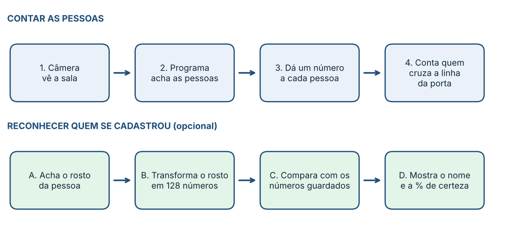
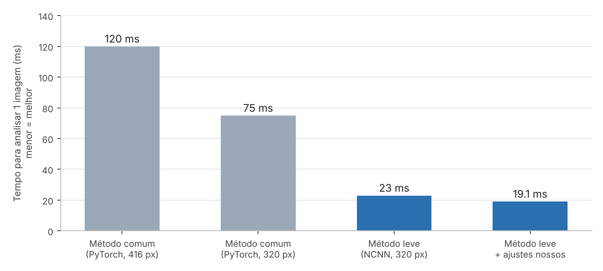

# Contador de Pessoas com Reconhecimento Facial

Sistema embarcado que **conta quem entra e sai de uma sala** e, de forma opcional e consentida, **reconhece pessoas cadastradas**, tudo em tempo real num **Raspberry Pi 5**, sem GPU e sem guardar nenhuma foto.

Projeto desenvolvido para a **15ª Jornacitec** (Fatec Botucatu, 3 a 6 de novembro de 2026).

> **Status:** versão **v0.7.1**. A lógica passou nos 232 testes automáticos. As melhorias mais recentes (contagem na porta e confiabilidade dos nomes) ainda estão em validação em sala de aula. Veja [Limitações e o que ainda não foi medido](#limitações-e-o-que-ainda-não-foi-medido).

📄 Explicação para quem não é da área: [`docs/explicacao_simples.pdf`](docs/explicacao_simples.pdf)

---

## O que ele faz

- **Conta entradas e saídas** por uma linha virtual na porta, com histerese para não contar duas vezes.
- **Acompanha cada pessoa** com um ID estável (rastreador próprio).
- **Cadastro por gesto e toque:** o visitante abre a palma da mão por 1 s, segue o guia de 5 poses da cabeça e digita o nome num teclado virtual.
- **Reconhece pessoas cadastradas** e mostra `Nome · 78%` (semelhança com o cadastro). Um mesmo nome nunca aparece em duas pessoas ao mesmo tempo, e o nome fica `?` quando o rosto não é conferido há alguns segundos.
- **Duas telas:** uma TV com o painel público e um monitor touch de 8" para o cadastro.
- **Privacidade:** só guarda embeddings (128 números por pose). Nenhuma foto ou vídeo é gravado.

## Como funciona



| Etapa | Quem faz |
|---|---|
| Captura da imagem | OpenCV (webcam USB) |
| Detectar pessoas | **YOLO11n** convertido para **NCNN** (sem PyTorch no Pi) |
| Dar ID a cada pessoa | Rastreador próprio (`rastreador.py`): IoU + velocidade + resgate |
| Contar | Linha virtual com histerese (`contagem.py`) |
| Achar rosto, pose e mão | **MediaPipe** (FaceLandmarker e GestureRecognizer) |
| Rosto → 128 números | **SFace** (OpenCV), com alinhamento por 5 pontos (recorte 112×112) |
| Guardar / comparar | SQLite + similaridade de cosseno (média das 2 melhores poses) |

Detalhes de projeto:
- O YOLO roda numa **linha de execução própria** (~12 detecções/s, entrada 320×320, 3 threads do NCNN) e o laço principal (~30 Hz) **extrapola as caixas** entre detecções.
- Tarefas pesadas (rosto, embedding, gesto) são **escalonadas** para nunca caírem no mesmo quadro.
- O painel é desenhado em **regiões com cache**, redesenhando só o que mudou.

## Resultados medidos

Medições feitas no próprio Raspberry Pi 5 (`yolo_teste.py`, uma pessoa em cena):

| Configuração | Tempo por quadro | FPS (só inferência) |
|---|---|---|
| PyTorch, entrada 416 | 120 ms | 8,4 |
| PyTorch, entrada 320 | 75 ms | 13,4 |
| NCNN, entrada 320 (Ultralytics) | 23 ms | 43,7 |
| NCNN, entrada 320 (runner próprio) | **19,1 ms** | **52,5** |



Trocar o PyTorch pelo NCNN tornou a inferência cerca de **3 a 4 vezes mais rápida** com o mesmo modelo. O FPS do sistema completo é menor, porque também captura, rastreia, reconhece e desenha duas telas. A primeira versão completa em sala rodou a 7,8 FPS (CPU 44%, 71 °C), o que motivou as otimizações das versões seguintes.

## Hardware

| Item | Detalhe |
|---|---|
| Computador | Raspberry Pi 5, Raspberry Pi OS 64 bits (Bookworm), Python 3.11 |
| Câmera | Webcam USB Logitech 1080p |
| Painel público | TV Full HD (1920×1080) |
| Cadastro | Monitor touch de 8" (1280×800) |

## Instalação

```bash
sudo apt update && sudo apt install -y python3-opencv python3-picamera2 python3-venv wget
python3 -m venv --system-site-packages ~/contador
source ~/contador/bin/activate
git clone https://github.com/MateusCourel/contador-pessoas.git
cd contador-pessoas
pip install -r requirements.txt
```

**Modelos** (não ficam no repositório; baixe uma vez na pasta do projeto):

```bash
wget -O gesture_recognizer.task https://storage.googleapis.com/mediapipe-models/gesture_recognizer/gesture_recognizer/float16/latest/gesture_recognizer.task
wget -O face_landmarker.task https://storage.googleapis.com/mediapipe-models/face_landmarker/face_landmarker/float16/latest/face_landmarker.task
wget -O face_recognition_sface_2021dec.onnx https://github.com/opencv/opencv_zoo/raw/main/models/face_recognition_sface/face_recognition_sface_2021dec.onnx
```

**Modelo do YOLO (NCNN):** crie a pasta `yolo11n_ncnn_model/` exportando o YOLO11n com a biblioteca Ultralytics (instalada à parte, só para exportar):

```bash
python yolo_teste.py        # benchmark e exportação em 320x320
python exportar_yolo.py     # opcional: modelo retangular 448x256 (melhor à distância)
```

## Como usar

```bash
source ~/contador/bin/activate
DISPLAY=:0 python principal.py
```

Opções úteis:

```bash
python principal.py --nao-organizar-telas     # não mexe na posição das telas
python principal.py --yolo-tamanho 448x256    # usa o modelo retangular
```

No Wayfire (Pi OS), o `organizar_telas.py` identifica sozinho a TV e o monitor touch (pelo que cada tela é, e não pela porta HDMI) e posiciona as janelas. Para abrir por ícone na área de trabalho, use `./instalar_atalho.sh`.

**Cadastros (LGPD):**

```bash
python cadastros.py                  # lista
python cadastros.py apagar 3         # apaga um
python cadastros.py apagar todos     # apaga tudo
```

## Estrutura

```
principal.py   nucleo.py            programa principal e orquestração
camera.py      deteccao.py          captura e YOLO (NCNN)
rastreador.py  contagem.py          IDs e linha de contagem
rosto.py  poses.py  embeddings.py   malha facial, poses, SFace
banco.py  identidades.py  fluxo.py  SQLite, nomes e cadastro
gestos.py  mao.py  teclado.py       gesto, esqueleto da mão, teclado virtual
painel.py (TV)  console.py (touch)  interfaces
telas.py  janelas.py  ponteiro.py  organizar_telas.py   duas telas no Wayfire
test_*.py                           testes automatizados
CHANGELOG.md                        histórico v0.1 a v0.7
```

## Testes

```bash
python -m unittest discover -p "test_*.py"
```

São 232 testes de lógica (rastreador, contagem, identidades, cadastro, banco, teclado, telas...). Eles não precisam de câmera nem de modelos.

## Privacidade e LGPD

- Só são guardados **nome e embeddings** (128 números por pose, 5 poses por pessoa). **Não há fotos nem vídeos gravados.**
- O cadastro é **voluntário**, com aviso e consentimento na tela antes de começar.
- Os dados ficam **apenas no dispositivo**, no arquivo `dados/pessoas.db` (que **não** deve ser enviado ao repositório; está no `.gitignore`).
- Os cadastros podem ser **apagados** a qualquer momento (`cadastros.py`).
- Embeddings faciais podem ser considerados **dados biométricos**; por isso o consentimento e a exclusão fazem parte do projeto.

## Limitações e o que ainda não foi medido

- **A acurácia da contagem ainda não foi medida** formalmente (contagem manual × sistema). Por isso este repositório não cita um percentual de acerto.
- As melhorias da v0.7 e v0.7.1 (inferência de entrada na porta, nome com `?`, soltura do nome, reconhecimento de rostos menores) passaram nos testes automáticos, mas **precisam de validação em sala com pessoas reais**.
- O reconhecimento piora com rosto pequeno, de lado, borrado ou com pouca luz, e pessoas parecidas podem se confundir (por isso as margens e a regra de um nome por pessoa).
- A porcentagem exibida é uma **escala de semelhança**, não uma probabilidade de acerto.

## Dificuldades do caminho

Parte importante do projeto foi fazer tudo funcionar no equipamento real:

- A **câmera CSI nunca foi reconhecida**; a solução foi a webcam USB, o que mudou o plano inicial.
- **FPS baixo e 71 °C** na primeira versão em sala, resolvidos com detecção em thread própria, NCNN, desenho por regiões em cache e escalonamento das tarefas pesadas.
- **Duas telas no Wayfire 0.7.5**, onde as regras de janela não funcionam: solução com `wlr-randr`, verificação com `xwininfo` e mouse virtual via `uinput`.
- **Contagem falhando na porta** e **nomes duplicados** (três "Mateus" para uma pessoa), corrigidos com rastreador mais firme, inferência de entrada e unicidade de nomes.
- **Nome "grudando" em outra pessoa** que passa na frente, tratado na v0.7.1.

O histórico completo está em [`CHANGELOG.md`](CHANGELOG.md).

## Roadmap

- [ ] Validar a v0.7.1 em sala e medir a acurácia (contagem manual × sistema)
- [ ] Recorte da cabeça em Full HD para reconhecer de mais longe
- [ ] Iniciar o programa sozinho ao ligar o Pi
- [ ] Painel web para acompanhar pelo celular, mapa de calor e alertas de lotação

## Equipe

- **Mateus Antonio Courel**
- **João Marcos André Almeida**
- **Davi Rodrigo de Miranda**
- Orientador: **Ricardo Rall**

## Licenças de terceiros

Este projeto usa componentes de terceiros, cada um com sua própria licença. Confira as originais antes de reutilizar:

| Componente | Licença (confira a oficial) |
|---|---|
| Ultralytics YOLO11 | AGPL-3.0 |
| MediaPipe | Apache-2.0 |
| OpenCV e OpenCV Zoo (SFace) | Apache-2.0 |
| NCNN | BSD-3-Clause |

## Licença

O código deste repositório está sob a licença MIT (veja `LICENSE`). Os modelos baixados e as bibliotecas de terceiros seguem as licenças acima.
